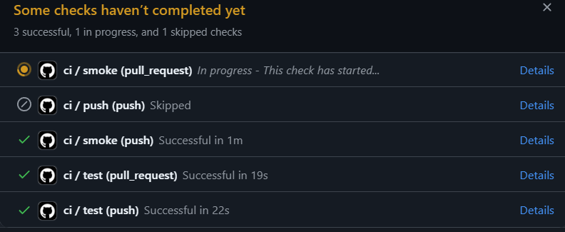
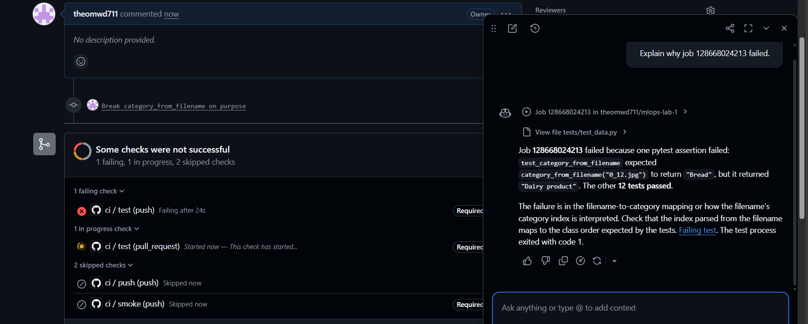
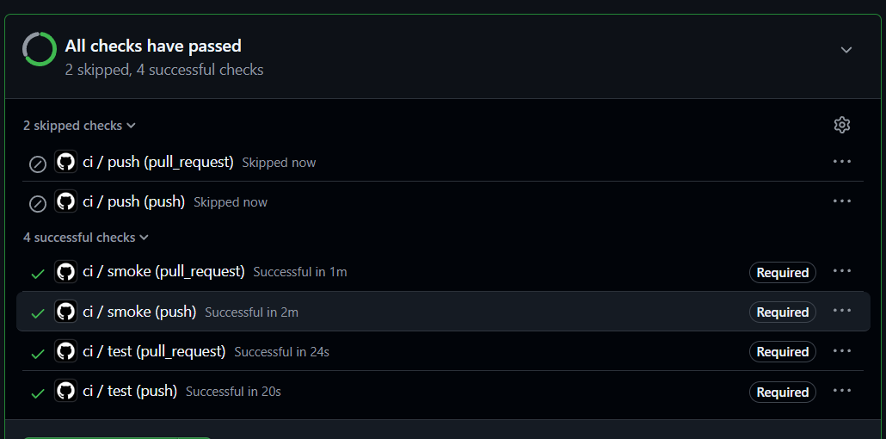
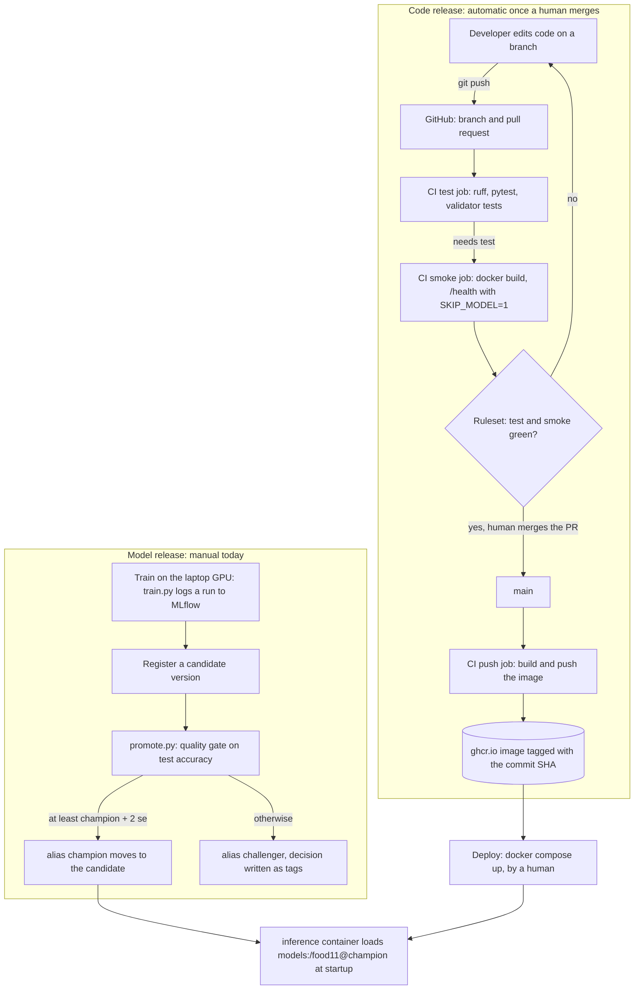

# Lab 5 — CI/CD with GitHub Actions

Answers are grounded in what was built and observed in this repo: the tests and
validator on `main`, `.github/workflows/ci.yml`, the GitHub Actions run history
(run numbers and timings below come from the Actions API), the branch ruleset, and
the three `promote.py` runs. Where something was not exercised, the answer says so.

## What was built

- **Testable code:** `src/food11/data.py` exposes `CLASSES`,
  `category_from_filename` and `resize_image`; `src/food11/serve.py` keeps the
  model in a module-level `model`, skips loading when `SKIP_MODEL` is set, and
  answers `/predict` with 503 when no model is loaded.
- **Tests (13 passing):** `tests/test_data.py`, `tests/test_api.py` (fake model),
  `tests/test_validate_data.py`, plus a real image fixture
  (`tests/fixtures/bread.jpg`, copied from `food11_processed_mini`).
- **Data contract:** `src/food11/validate_data.py` (five checks, non-zero exit on
  failure).
- **Pipeline:** `.github/workflows/ci.yml` with three jobs — `test`, `smoke`,
  and `push` (only on `main`, image tagged with the commit SHA in ghcr.io).
- **Protection:** a branch ruleset on `main` requiring a pull request and the
  `test` and `smoke` checks, with an empty bypass list.
- **Model gate:** `src/food11/promote.py`.

### Deviations from the lab text (and why)

- **`uv sync --frozen --no-install-project`, not plain `uv sync --frozen`.** The
  `src/mlops_lab_1/` stub that `uv_build` wants is not tracked by git, so on a
  fresh checkout a full sync fails to build the project package — the same error
  the first Docker build hit in Lab 3.
- **CPU-only torch without touching `pyproject.toml`.** The lock pins CUDA torch
  (`cu126`), which I still need locally for GPU training. The `test` job builds
  its `--no-install-package` list from `uv.lock` (`torch`, `torchvision`,
  `triton`, `nvidia-*`, `cuda-*`: 21 packages) and then installs CPU wheels with
  `uv pip install --index-url https://download.pytorch.org/whl/cpu torch torchvision`.
  Excluding `torch` alone is not enough, because its CUDA dependencies are
  separate entries in the lock (the Lab 3 lesson).
- **`uv run --no-sync`** for `ruff` and `pytest`, otherwise `uv run` re-syncs the
  environment and reinstalls the CUDA packages that were just excluded.
- **Ruff rules pinned** in `pyproject.toml` (`select = ["E4", "E7", "E9", "F"]`).
  Newer ruff versions enable many more rules by default (import sorting,
  `B008`, ...), so the lint result would otherwise depend on whichever version
  gets locked. With the classic set, only four things failed on the existing
  code: three `E402` in `serve.py` (the CPU `torch.load` patch sat between the
  imports, so I moved it below them) and one `F541` stray f-string in `train.py`.
- **`pytest` `pythonpath = ["."]`**, because `src/` has no `__init__.py` and the
  tests import `src.food11...`.
- **Health-check loop of 30 tries** instead of 20, to leave room for importing
  `torch` and `mlflow` on a shared runner.
- **Ruleset instead of a classic branch protection rule** (GitHub's current UI).

## Q1 — Why a unit test should not load the real model from MLflow

Ways it can fail even though the code is correct:

1. **No server.** The test needs a reachable MLflow tracking server; a CI runner
   or a fresh laptop has none, so the call fails with a connection error. The
   Compose server in this project only runs on my machine.
2. **The registry moves.** `models:/food11@champion` points at whatever version
   currently holds the alias. During Q10 the alias moved v1 → v2 → v3, so a test
   asserting on real predictions would change result without any code change.
3. **Loading is fragile in its own right.** In Labs 3 and 4 the *same* load call
   failed with a 403 `Invalid Host header`, an unresolvable `file:C:/...`
   artifact path, and a CUDA-tensor-on-CPU `RuntimeError` — none of which are
   bugs in the code under test.
4. **Slow and non-deterministic.** It downloads the model artifacts on every run,
   and a retrained model gives different predictions, so a test can't assert on
   them. There is also no GPU on the runner.

## Q2 — What `test_predict_returns_valid_json` proves, and what it doesn't

**Proves (the glue code):** the endpoint accepts a multipart upload; the image is
decoded and converted to RGB; the transform produces what `model.predict`
receives; the model's raw output is turned into a softmax, an argmax and the
right category name; and the JSON has a `category` string and a `confidence`
float in [0, 1]. The version in this repo also checks the confidence against the
expected softmax value (0.9369 for logits `[5, 0, ..., 0]`), which pins the math
and the rounding. Sibling tests cover the 503 path when no model is loaded, and
that `serve.CATEGORIES` equals `data.CLASSES` (guarding against label-order
drift).

**Does not prove:** that the model is accurate (the fake always says "Bread");
that the registered model actually loads (alias exists, artifacts download,
dependencies compatible); that the preprocessing matches what the model was
trained with; that the real model's output has the same shape as the fake's;
that the class order the model learned matches `CATEGORIES`; or anything about
speed, memory or GPU/CPU behaviour. Those need an integration test against the
real model — which is exactly what the Compose stack from Lab 4 is for.

## Q3 — Which check caught the duplicate, and why duplicates are more dangerous

`validate_data.py` check 4, **"no image shared between splits"** (an md5 of each
file's bytes). It reported `FAIL` already on the untouched mini dataset: **43
files** in `validation`/`evaluation` are byte-identical to images in other
splits (5 listed plus "+38 more"; 3,292 images checked, so about 1.3%). Copying
one training image into `evaluation/Bread` raised the count by exactly one, and
removing it restored it:

```
baseline                 (+38 more)
after copying a file     (+39 more)
after removing the copy  (+38 more)
```

A corrupted image makes the training script crash: loud, immediate, and cheap to
fix. A train/test duplicate raises no error at all — the run succeeds and
reports an accuracy that is quietly too high, because the model is evaluated on
images it trained on. Every decision built on that number (comparing runs,
the promotion gate) inherits the error, and nobody notices. The 43 real
duplicates mean this project's test accuracies are slightly optimistic.

## Q4 — Where `validate_data.py` should run when CI can't see the data

1. **In CI, against a small generated dataset.** `tests/test_validate_data.py`
   builds a tiny valid dataset in a temp folder and checks that the validator
   passes it and fails it for a cross-split duplicate, a wrong-size image, and a
   missing class folder. It runs inside the normal `pytest` step, so every push
   verifies the *validator itself* without needing DVC.
2. **Where the data lives.** Run it on the machine that has the data, as a gate
   before the data is used or published: as a step before `dvc add`/`dvc push`
   (hook or script), and at the start of `train.py`, so a bad dataset fails in
   seconds instead of after a GPU run.

A third option needs a hosted DVC remote: a CI job that `dvc pull`s the data and
validates it. That isn't possible here because the DVC remote is a local folder
(Lab 1).

## Q5 — `needs: test` on the `smoke` job

If a unit test fails, `smoke` **does not run**: it is marked skipped, no runner
time is spent building the image, and because `smoke` is a required check the PR
cannot merge. The failing-PR screenshot in Q9 shows exactly this (`test` red,
`smoke` skipped).

Without `needs`, both jobs would start at the same time on separate runners. The
Docker build would run even though the tests are red (wasted minutes), and the PR
would show mixed results (`smoke` green, `test` red). When everything passes the
workflow would finish sooner, since the jobs overlap — the trade-off is cost and
noise versus wall-clock time.



## Q6 — Timing, first run versus second run

From the Actions API (runs on `ci-cd-pipeline`, then on `main`):

| Run | Total | `test` | `smoke` | `push` |
|---|---|---|---|---|
| #1 first push (branch) | 2 m 11 s | 22 s | 1 m 40 s | skipped |
| #4 empty commit (branch) | 2 m 13 s | 25 s | 1 m 43 s | skipped |
| #3 first merge to `main` | 6 m 04 s | 28 s | 1 m 41 s | **3 m 45 s** |
| #11 later merge to `main` | 2 m 22 s | 22 s | 1 m 35 s | **18 s** |

Step level:

| Step | Run #1 | Run #4 |
|---|---|---|
| Install dependencies (CPU-only torch) | 4 s | 4 s |
| `pytest` | 11 s | 15 s |
| `smoke`: `docker build` | 79 s | 81 s |

Run #1 → #4 changed nothing measurable: the dependency install takes about 4
seconds either way, so the `uv` cache from `setup-uv` has almost nothing to save
on a runner with a fast network, and `smoke` uses a plain `docker build` with no
layer cache, so it rebuilds every layer each time. The step that got dramatically
faster is **`docker/build-push-action` in the `push` job: 3 m 19 s → 4 s** between
the first and the latest merge to `main`. It is configured with
`cache-from/cache-to: type=gha`, and since the Dockerfile and `src/` were
identical between those two builds, every layer (base image, dependency install,
the CPU torch download) came from the cache.

## Q7 — Why tag with the commit SHA instead of `latest`

A SHA tag is immutable and names exactly one commit; `latest` is a pointer that
is overwritten by every push. A concrete failure with `latest`: on Monday laptop
A pulls `ghcr.io/theomwd711/mlops-lab-1:latest`. On Tuesday CI builds a new
image from newer code and moves `latest` to it. On Wednesday server B pulls
`latest`. Both now run "latest" but different code — and `docker run` doesn't
re-pull an image that already exists locally, so A stays on Monday's code
without anyone noticing. With `latest` you also can't say which commit a
running container came from, can't roll back (rollback to what?), and can't
reproduce a bug. With SHA tags, rollback is "deploy the previous SHA".

This answers Lab 3 Q9: the image used to exist only in my laptop's Docker cache.
Each merge to `main` now pushes an image that any machine can pull and that
identifies its commit — the `push` job ran green on `main` for `ecacc35…` and
`b8a1e04…`, and the run for `884bd25…` was green as well.

## Q8 — Why the `push` job declares `permissions:`

`GITHUB_TOKEN` can carry broad rights depending on the repository's default
setting. Declaring `contents: read` (checkout) and `packages: write` (push the
image) is least privilege: the job gets only what it needs. If a step were
compromised — a third-party action, a poisoned dependency, a malicious change to
the workflow — a token with write access to everything in the repo could push
commits or tags, modify workflows (including this one) to persist the attack,
create releases, tamper with or delete other packages, and rewrite or delete
branches. A narrow token limits that to publishing one package.

Hardening note: the `test` and `smoke` jobs have no `permissions:` block, so they
use the repository default. Adding a top-level `permissions: contents: read`
would tighten them as well; the `test` job runs the most third-party code
(dependency installs) and needs no write access at all.

## Q9 — The failing pull request

The ruleset on `main` requires a pull request and the `test` and `smoke` checks,
with an empty bypass list. On a branch I changed `category_from_filename` to
return `CLASSES[(index + 1) % len(CLASSES)]` and opened a PR:



- **What the page shows:** `ci / test` fails (marked *Required*): the assertion
  in `test_category_from_filename` expected `Bread` for `0_12.jpg` and got
  `Dairy product`, while the other 12 tests passed. `ci / smoke` (also
  *Required*) is skipped because of `needs: test`, and `push` is skipped because
  the branch isn't `main`. The run history agrees: runs #7 (push) and #8
  (pull request) on the breaking commit `1ef87fd` failed.
- **Could I still merge?** No — with required checks failing and nobody on the
  bypass list, GitHub blocks the merge.
- After the fix (`3c28709`), runs #9 and #10 passed and the PR merged. A later PR
  (the one that added `promote.py`) shows the healthy case — all four runs green,
  with the *Required* badge on `test` and `smoke`, and `push` skipped off-`main`:



**What it changes for a team** compared with "everybody runs the tests on their
laptop first": the check no longer depends on memory or goodwill. It runs
automatically on a clean machine with the locked dependencies (no "works on my
machine"), the result is visible to every reviewer on the PR, a broken change
simply can't be merged, `main` stays green and deployable, and images are only
ever built from commits that passed.

## Q10 — The quality gate on three candidates

`promote.py` reads `test_accuracy` from the candidate's run and the champion's
run, estimates the champion's standard error `se = sqrt(p(1-p)/n)` with
`n = 1096` (the images in `food11_processed_mini/evaluation`), and promotes only
if the candidate scores at least `champion + 2·se`. It writes the decision and
both accuracies as tags on the candidate version (`gate.decision`,
`gate.candidate_accuracy`, `gate.champion_accuracy`, `gate.champion_version`,
`gate.test_set_size`, `gate.threshold`).

| Candidate | Settings | Test accuracy | Champion | `2·se` | Needed | Decision |
|---|---|---|---|---|---|---|
| v2 | lr 1e-5, 5 epochs | 0.5301 | v1, 0.4626 | 3.01 points | ≥ 0.4927 | **promote** → `champion` = v2 |
| v3 | lr 1e-3, 12 epochs | 0.5675 | v2, 0.5301 | 3.02 points | ≥ 0.5603 | **promote** → `champion` = v3 |
| v5 | lr 1e-5, 1 epoch | 0.1451 | v3, 0.5675 | 2.99 points | ≥ 0.5974 | **reject** → `challenger` = v5 |

`2·se` is about **3 accuracy points**, roughly 33 of the 1096 test images:
differences smaller than that are treated as noise. v2 beat v1 by 6.75 points,
well past the 3.01-point margin, because the starting champion v1 was a weak run
(0.4626). v3 beat v2 by 3.74 points against a 3.02-point margin, only 0.7 points
over the threshold, so it is a close call; its training also had noisy
validation accuracy (0.60 at epoch 10, 0.42 at epoch 11), and the reported
number is the final-epoch model. Note too that the 43 duplicate images from Q3
inflate all of these accuracies slightly.

**The rejection path, for real.** v5 is a deliberately weak candidate (one epoch
at lr 1e-5). It scored 0.1451, far under the 0.5974 it needed, so the gate printed
`REJECT`, tagged v5 with `gate.decision = rejected` and the numbers above, and moved
only the `challenger` alias to it. `champion` stayed on v3, so the running service
is unaffected, and the rejected model stays in the registry with its reason
attached. A near-miss, such as a candidate within the 3-point margin, would be
rejected the same way, which is the point: a difference smaller than the noise
doesn't earn a promotion.

## Q11 — Running `promote.py` automatically after training

The MLflow server lives on my laptop (a Compose container on `localhost:5000`),
which a GitHub runner cannot reach. Ways around it:

1. **Make MLflow reachable from CI.** Use a hosted MLflow (the DagsHub one per
   repository, or a small VM), store its URL and credentials as GitHub Secrets,
   and add a workflow (manual `workflow_dispatch`, or triggered when a training
   run finishes) that runs `promote.py` with `MLFLOW_TRACKING_URI` set.
2. **Run it where MLflow already is.** Call `promote.py` as the last step of the
   training pipeline on the machine that trains (a script or `make` target that
   runs `train.py`, registers the version, then `promote.py --version N`), or
   register a **self-hosted runner** on that machine so a GitHub workflow can
   reach `localhost:5000`.

## Q12 — The pipeline from `git push` to a running container



| Step | Automatic or human | Where the version is decided |
|---|---|---|
| Lint, unit tests, data-contract tests | Automatic on every push and PR | — |
| Docker build and `/health` smoke test | Automatic, only if `test` passed | — |
| Merging the PR | **Human**, but blocked by the ruleset until checks pass | **Code version** = the merged commit's SHA |
| Image build and push to ghcr.io | Automatic on `main` | Image tag = that commit SHA |
| Data version | **Human** (`dvc add`/`dvc push`, commit `data.dvc`) | The hash in `data.dvc` |
| Training and registering a candidate | **Human**, on the laptop GPU (CI never trains) | A new registry version number |
| Promotion | **Human runs `promote.py`**, the **gate decides** | **Model version** = what the `champion` alias points to |
| Deploy and reload | **Human** (`docker compose up`, `docker compose restart inference`) | — |

The image and the model are released independently: the image is selected by
commit SHA, the model by the registry alias. Changing the champion needs no new
image, because the container loads `models:/food11@champion` when it starts. The
main gaps are that nothing deploys the new image automatically and that
`promote.py` isn't triggered by CI (Q11).
